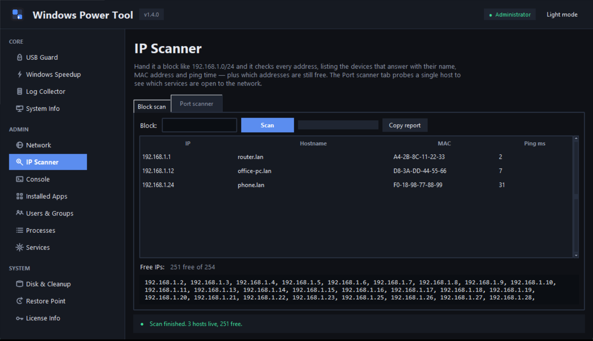

# Windows Power Tool

[](LICENSE)

A portable Windows admin toolbox that always runs elevated. Python and tkinter, one exe, fourteen tools, no runtime dependencies.



## Download

Get **WindowsPowerTool.exe** from the [latest release](https://github.com/agentTequila/windows-power-tool/releases/latest) and run it. Windows asks for Administrator rights through UAC, which is expected: the tool needs them.

> **SmartScreen:** the exe is unsigned, so Windows may show "Windows protected your PC". Click **More info → Run anyway**.

## What's new in 1.4.0

- **IP Scanner** — sweep a block, see every host with its name, MAC and ping time, get the addresses that are still free, and port-scan a single machine.
- **Add User** — create a local account from Users & Groups, with the exact commands shown before anything runs and the password kept out of the preview.

## Tools

### Core

| Tool | What it does |
|---|---|
| **USB Guard** | Blocks USB storage through the Windows Removable Disks policy (read and write). A blocked drive still shows up in This PC, but opening it gives Access Denied. Keyboards, mice and printers are never touched. Reconnect the drive after a change; some builds need a restart. |
| **Windows Speedup** | Clears `%TEMP%`, `Windows\Temp`, Recent and Prefetch. Optionally wipes browser cache and cookies (Chrome, Edge, Firefox) and opens the browser again after. Pick clean-only or clean-and-reboot, the reboot coming with a 10-second countdown you can cancel. |
| **Log Collector** | Grabs Application/System/Security/Setup event logs from the last N minutes, filtered by level. Saves as `.txt`, `.csv`, or native `.evtx`. |
| **System Info** | Hostname, OS, IPs and MAC addresses, local users and groups, hardware, storage (removable included), uptime. Copy it or save to a text file. |

### Admin

| Tool | What it does |
|---|---|
| **Network** | Flush the DNS cache, release or renew the IP, run a paced live ping, or switch an adapter between DHCP and a static address. Command output lands underneath. |
| **IP Scanner** | Sweep a block like `192.168.1.0/24` to see which addresses answer, with hostname, MAC and ping time. Free addresses are listed separately, and a stop only reports what was actually checked. The port scanner probes one host for open TCP services. Read-only: ping, ARP lookup and TCP connects. |
| **Console** | A one-shot PowerShell or CMD box inside the app. Output streams live, Stop kills the command tree, Up/Down recalls earlier commands, and the buttons open a real console in your profile. |
| **Installed Apps** | Everything sitting in the Windows uninstall hives, with search as you type. Export to CSV, or hit Uninstall, which runs the program's own uninstaller after asking you first. A leftover scan can then find folders and registry keys it left behind. |
| **Users & Groups** | Local accounts: add, group membership, password reset, enable, disable, delete. Add User asks for a name and password, shows the commands with the password masked, then creates the account. Anything destructive asks first. |
| **Processes** | Live table of running processes with search. Ending a task always confirms. |
| **Services** | The same treatment for services: search, start, stop, restart and change startup type, every one of them confirmed before it runs. |

### System

| Tool | What it does |
|---|---|
| **Disk & Cleanup** | Fixed and removable drives with size, free space and file system. A button opens Windows' own Disk Cleanup, so you choose what gets deleted. |
| **Restore Point** | Shows the existing restore points and lets you create a new one, with confirmation. |
| **License Info** | Windows edition, product key (from the registry, or the OEM source when that's what's available) and activation status. If Office is installed, its license status shows up too. Copy the block or open Windows activation settings. |

## Requirements

- Windows 10 or 11
- Python 3.13 or newer, only if you run from source (the exe needs nothing)
- Administrator rights (the exe asks through UAC on launch)

## Run from source

```powershell
python run.py
```

## Tests

```powershell
python -m unittest
```

The suite covers the pure logic and the UI wiring. Registry reads, PowerShell, services and network calls are mocked, so the tests do not touch the machine they run on.

## Build the portable exe

```powershell
pip install -r requirements.txt
pyinstaller --noconfirm build.spec
```

Output lands in `dist\WindowsPowerTool.exe` (onefile, no console, asks for admin on launch). To regenerate the app icon, run `python assets/generate_icon.py`, which needs Pillow. The sidebar icons live in `assets/icons/` and are rebuilt by `python assets/generate_icons.py`.

## Notes

- Nothing gets written next to the exe. Your theme choice lives in `%LOCALAPPDATA%\WindowsPowerTool\settings.json`.
- Locked or in-use files are always skipped. Nothing is ever force-deleted.
- Service control, account changes, uninstall, leftover removal and restore points: all confirm first. Reads, refreshes and scans never prompt.
- USB Guard writes the Removable Disks policy. Reconnect the drive after blocking or allowing; if Windows still enforces the old state, restart. It works on Pro, Enterprise and Education; Windows Home does not expose that policy.
- The IP Scanner only reads: one ping per address, the local ARP table, and TCP connection attempts. It never changes a host.

## License

PolyForm Noncommercial 1.0.0: free to use, modify and share for noncommercial purposes, but selling the software or derived versions isn't permitted. Full text in [LICENSE](LICENSE).
